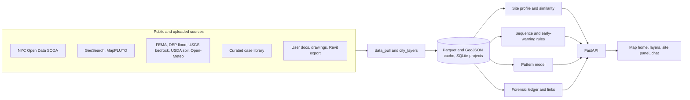

# ForeSite: build goal (Sun Nov 15, 12:00 PM)

## What we are building
**ForeSite** is the name the team picked in session 3. It is a **3D map of NYC that serves as home base**, with a chat docked beside it.
- **Users:** an architect, who coordinates the project and is usually the applicant of record, and a structural engineer. They work in one shared project.
- **Starting a site:** pick any site on the map.
- **Data:** each source appears as a toggleable layer. The data a user needs right now is surfaced first; everything else stays filtered, not deleted.
- **Two use cases on the same map and data:**
  - **Foresight, predictive:** before and during work, what does this site's profile look like across the city, and which record patterns are early warnings?
  - **Forensics, after an event:** index a large pile of documents and public records into a dated evidence ledger. Help the user link evidence and surface findings for their report.

### Decisions from session 3 ([transcript part 3](../transcripts/team_brainstorm_2026-11-14_part_3.md))
- **The map is the centerpiece.** It should look more realistic than plain blocks, but clear information matters more than detail.
- **Map plus chat:** look something up, ask about it, and save the answer into the project context.
- **The flow is not sequential.** Drawings and models arrive weeks later, and the user adds them whenever they are ready.
- **Zoning, FAR and similar lot facts** are side info, not a step the user has to stop at.
- **Work types are inferred** from the job type, using the DOB NOW structure. Everything is on by default, and the user can untick items.
- **Revit reader:** one-way, one button, already built and tested on a sample model. It extracts the structural system, foundations and bearing walls. Drawings can also be read by AI to get the structural system type.
- **DOB is not a user for now.**
- **Do not open with Nov 11.** The hero site is decided later.
- **Pitch:** 5 minutes total. About 1 minute of slides, 1 minute of video, 1 to 2 minutes of live demo, then a wrap-up by persona.

### What the forensic advisor said, built in as requirements
- **State limitations prominently.** "Checking these boxes doesn't mean you're good." A "What ForeSite doesn't know" panel is always visible, and checklists are labeled "not exhaustive".
- **Weather and soil are often material:** rain, freeze-thaw cycles, soil type, and depth to bedrock. These become timeline events and site context.
- **Predictive angle:** pull records every day and flag sequences, for example "a violation, then nothing recorded for 3 weeks". Also flag "these 3 steps came before incidents N times".
- **Forensic angle:** help maintain the ledger, suggest relationships, and let the user codify why two items are linked. The result works as a project index for the report.
- **Education:** past "horror stories" are a library of lessons learned for junior staff.
- **Pick one or two users:** architect plus structural engineer.

## Architecture

## Data sources (all pulled in, by hazard)
These are keyless unless noted. Items marked "verified" were checked live on 2026-11-14; the rest are confirmed in hour 1.
- **Core lot and building data:**
  - GeoSearch
  - PLUTO `64uk-42ks`
  - MapPLUTO in feet (EPSG:2263)
  - Building Footprints `5zhs-2jue`, with roof height and ground elevation
  - Landmarks: the PLUTO flag, plus LPC permits `dpm2-m9mq`
  - Code era, derived from year built
- **Construction and DOB records** (already in `data_pull/lot_records.py` `DATASETS`):
  - DOB NOW filings `w9ak-ipjd`, with work types, SOE and special inspections
  - Violations `3h2n-5cm9`
  - Safety violations `855j-jady`
  - ECB `6bgk-3dad`
  - Complaints `eabe-havv`, plus the imported category key: 03 adjacent not protected, 14 excavation undermining, 16 inadequate shoring, 30 structural stability, 54 retaining wall, 2K structurally compromised, 5C (verified)
  - 311 routed to DOB `erm2-nwe9`
  - Stop-work mentions, found in ECB text
- **Incidents and severity across the city:**
  - Construction-Related Incidents `bf97-mjsy`. It has a type such as Excavation/Soil Work or Scaffold/Shoring, fatality and injury counts, and coordinates; 2024 onward (verified).
  - HPD vacate orders `tb8q-a3ar`, with the reason (Fire Damage and so on) and coordinates (verified).
  - FDNY building vacate list `n5xc-7jfa` (verified).
  - HPD violations `wvxf-dwi5`, shown but never scored as structural.
- **Facades and falling debris:** façade compliance filings `xubg-57si`. There are 5,627 marked UNSAFE and 32,504 SWARMP, which means safe with a repair and maintenance program (verified).
- **Flooding and water:**
  - FEMA flood zones (the NFHL ArcGIS service)
  - DEP Stormwater Flood Maps `9i7c-xyvv`
  - Sandy Inundation Zone `uyj8-7rv5` (verified)
  - 311 street, sewer and basement flooding complaints
  - Complaint code 85, drainage
- **Geotech and soil:**
  - USGS depth-to-bedrock rasters (sampled at the site)
  - USDA SSURGO soil map unit via Soil Data Access. For example, "Urban land-Flatbush complex" (verified).
- **Contamination and hazardous materials:**
  - E-Designations `hxm3-23vy` (verified)
  - NYS DEC environmental remediation sites on data.ny.gov (confirm the ID)
- **Weather, for timelines:** Open-Meteo archive, with daily precipitation and minimum and maximum temperature (verified). From this we derive heavy-rain days and freeze-thaw cycles.
- **Curated case library:** 40 or more NYC cases spread across hazards and severity levels. Each case has its source URLs and its cause "as publicly reported" or "under investigation". Seed it with the cases already researched: 211 E 34th, 714 39th, 656 Myrtle, 102-02 Liberty, 97 Quincy, 1915 Billingsley, 57 Ann, 235 E 42nd, 161 Maiden Lane, and 1321 Flatbush. Add gas explosions, façade deaths, crane incidents, Ida basement flooding, and fire vacates.
- **Severity scale used everywhere:**
  - 0, signal: a complaint
  - 1, enforcement: a violation, stop-work order or vacate
  - 2, incident: injury or partial collapse
  - 3, catastrophic: fatality or full collapse
- **Rules carried over from the team docs:**
  - No owner, applicant or contractor names.
  - A failed query is never shown as zero.
  - As-of means "dated before that day".
  - Never join on a dummy BIN.
  - 311 requests and DOB complaints are never added together.

## Use case A: Foresight (predictive)
1. **Site profile:**
   - Neighbors: whether they are attached, plus age, floors, construction class and height difference.
   - Job type, with the work types inferred from it.
   - Soil, bedrock depth, flood zones and E-designation.
   - Record signals.
   - Structural system, from the Revit export or drawings when they exist.
2. **Similar-profile cases across the city:** a weighted similarity over the profile features (kNN). It returns cases from the curated library and incidents from open data. They appear as map dots colored by hazard and sized by severity, with filters for hazard, severity and date. Each match explains itself, for example "matches on: pre-1940 attached masonry neighbor, excavation, same soil complex".
3. **Early-warning sequence rules,** run over the dated records with an as-of date. Examples:
   - A violation for unprotected adjacent property, then no follow-up record within 21 days.
   - A stop-work mention, then a "work continued" violation.
   - Complaint code 30, 14 or 16 within 90 days of an earth-work filing next door.
   - Heavy rain or freeze-thaw during an open excavation.
4. **Citywide watchlist layer:** active DOB NOW earth-work, foundation or SOE filings next to attached pre-1940 lots. It is precomputed to GeoJSON and refreshed by a scheduled pull. This is the "pull every day" idea.
5. **Pattern model (ML):**
   - **Label:** a severe-signal or incident event on a lot within 12 months of an earth-work filing on a touching lot, drawn from codes 30, 14, 16 and 5C, vacates, and `bf97-mjsy`.
   - **Features:** the profile features plus record history.
   - **Model:** gradient boosting with feature attributions, in a time-split evaluation.
   - **How it's shown:** as "pattern score vs. similar sites", never as a prediction that a building will fail. The calibration and limitations are shown with it.
   - **Sequence mining:** find which event sequences most often came before incidents, and feed them back into rule 3.
6. **Actions by discipline:** the existing checklist engine (BC 3309 duties) plus hazard rules, grouped for the architect, the structural engineer, geotech, and the contractor. Each item has an owner, a status and the proof it needs. Proof is never inferred from public data.

## Use case B: Forensics (post-event)
1. **Open a case:** click an incident on the map, or enter an address plus an event date.
2. **Automatic public-record ledger:** every dated record for the site and its touching lots, plus weather, the soil and bedrock context, the code era, and any zoning change. Each event carries its source and date.
3. **Document dump ingestion:**
   - Accepted inputs: PDFs, photos, drawings, reports and news articles.
   - Text extraction and OCR, then an LLM pulls out events with page-level citations (date, actor role, action, element), classified as fact, claim or opinion.
   - Everything is indexed for search and chat.
4. **Relationship ledger:**
   - The AI suggests links such as "same element", "follows", "contradicts" or "caused-as-reported".
   - The user confirms or rejects each link and writes why it matters. Only confirmed links count as findings.
5. **Findings surfacing:**
   - What changed in the 30 days before the event.
   - Contradictions between records, for example SOE marked "No" on a filing that also lists an SOE special inspection.
   - Gaps such as inspections or documents that are expected but missing.
   - Comparable cases.
6. **Report draft export:** a timeline, the confirmed links and the findings, each with citations. Every line is labeled as public record, uploaded document, AI suggestion, or user finding.

## Shared foundation
- **Map home:**
  - Built on MapLibre (existing `jahleel/web/src/features/site_map/site_map_view.tsx`) plus a deck.gl overlay for the citywide layers.
  - Google Photorealistic 3D Tiles appear when a key is available. Otherwise the fallback is extruded footprints, and the DCP 3D model for close-ups.
  - A layer panel lists every source with a toggle, so the user can see what's loaded.
- **Project workspace:**
  - SQLite in FastAPI holds projects, members (architect, SE), items, assignments, notes, saved chat answers, uploads and links.
  - For the demo, two browser tabs act as the two roles.
- **Chat:** extend `jahleel/api/chat/`, which already answers from the brief and web search with typed sources. Add tools to search the ledger, toggle layers, fly to sites, and save answers to the project.
- **Model and drawing input:**
  - The teammate's Revit reader posts `structural_model.json` (system material, gravity and lateral systems, foundation type, bearing walls on the lot line) to `/api/projects/{id}/model`.
  - A drawing PDF goes through a vision LLM that classifies the structural system type.
  - Either input updates the profile, the similar cases and the risk items.
- **Reuse, not rewrite:**
  - `data_pull/site_brief_pull.py`
  - `checklist/build_checklist.py`
  - `jahleel/api/brief/brief_build.py`
  - the chat module
  - the as-of logic
- **Rename:** PreFlight becomes ForeSite in the UI and the docs.

## New code layout, beside the existing modules
- `city_layers/`: citywide pulls into Parquet and GeoJSON. Covers incidents, vacates, facades, flood, E-designations, the watchlist and the case library.
- `profile/`: site profile, similarity, explanations.
- `foresight_model/`: label building, features, training, evaluation, sequence mining, the early-warning rules.
- `forensics/`: ingestion, extraction, the ledger, link suggestions, findings, report export.
- `jahleel/api/`: new routers for `layers`, `projects`, `foresight`, `forensics`.
- `jahleel/web/src/features/`: `city_map`, `layer_panel`, `similar_cases`, `early_warnings`, `forensic_case`, `timeline`, `link_graph`, `project`, `limitations`.

## Timeline (Sat 6 PM to Sun 12 PM)
- **Before 7 PM:** kick off and assign workstreams. Run the hour-1 data gate on the unconfirmed source IDs.
- **7 PM to 11 PM:** city layers and the case library; the map home and layer panel; profile and similarity; project store; forensic ingestion and extraction.
- **11 PM to 4 AM:** early-warning rules and the watchlist; model training and evaluation; ledger, links and findings; chat tools; Revit and drawing input.
- **4 AM to 9 AM:** integrate both use cases end to end; 3D tiles; the limitations panel; seed 2 to 3 candidate hero sites and 1 forensic case.
- **9 AM to 11 AM:** deploy, cache the demo data, record the 1-minute video, build the slides, rehearse the 5-minute pitch. Feature freeze at 11:00.

## Cut order if short on time
1. Google 3D tiles (use extruded footprints instead).
2. The ML model (keep similarity and rules).
3. Drawing vision.
4. The live daily refresh (use a precomputed watchlist).
5. Report export (show it on screen only).

Never cut: the map home with layers, similar cases, early-warning rules, the forensic ledger with confirmed links, and the limitations panel.

## Done means
- Any NYC address can be picked on the map. Its profile, similar cases across every hazard and severity level, the early warnings, and actions by discipline load from live or cached data.
- A forensic case turns public records plus an uploaded document set into a cited timeline, links confirmed by the user, and surfaced findings.
- Two roles share one project.
- Every claim shows its source and date.
- Limitations are visible on every screen.
- After you confirm, a Cursor long-running goal is created from this plan.
