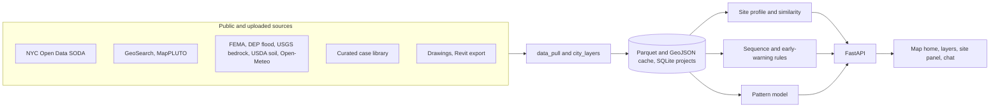
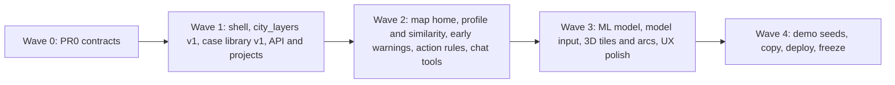

# ForeSite: build goal (Sun Nov 15, 12:00 PM)

## What we are building
**ForeSite** is the name the team picked in session 3. It is a **3D map of NYC that serves as home base**, with a chat docked beside it.
- **Users:** an architect, who coordinates the project and is usually the applicant of record, and a structural engineer. They work in one shared project.
- **Starting a site:** pick any site on the map.
- **Data:** each source appears as a toggleable layer. The data a user needs right now is surfaced first; everything else stays filtered, not deleted.
- **Main build, Foresight (predictive):** before and during work, what does this site's profile look like across the city, and which record patterns are early warnings?
- **Next step, Forensics (after an event):** index a large pile of documents and public records into a dated evidence ledger, and help the user link evidence and surface findings for their report. It is kept out of the main build to stay focused, and appears in the pitch as the next step.

### Decisions from session 3 ([transcript part 3](transcripts/team_brainstorm_2026-11-14_part_3.md))
- **The map is the centerpiece.** It should look more realistic than plain blocks, but clear information matters more than detail.
- **Map plus chat:** look something up, ask about it, and save the answer into the project context.
- **The flow is not sequential.** Drawings and models arrive weeks later, and the user adds them whenever they are ready.
- **Zoning, FAR and similar lot facts** are side info, not a step the user has to stop at.
- **Work types are inferred** from the job type, using the DOB NOW structure. Everything is on by default, and the user can untick items.
- **Revit reader:** one-way, one button, already built and tested on a sample model. It extracts the structural system, foundations and bearing walls. Drawings can also be read by AI to get the structural system type.
- **DOB is not a user for now.**
- **Do not open with Nov 11.** The hero site is decided later.
- **Pitch:** 5 minutes total. About 1 minute of slides, 1 minute of video, 1 to 2 minutes of live demo, then a wrap-up by persona.

### What the forensic advisor said, built in as requirements
- **State limitations prominently.** "Checking these boxes doesn't mean you're good." A "What ForeSite doesn't know" panel is always visible, and checklists are labeled "not exhaustive".
- **Weather and soil are often material:** rain, freeze-thaw cycles, soil type, and depth to bedrock. These become timeline events and site context.
- **Predictive angle:** pull records every day and flag sequences, for example "a violation, then nothing recorded for 3 weeks". Also flag "these 3 steps came before incidents N times".
- **Forensic angle (next step):** help maintain the ledger, suggest relationships, and let the user codify why two items are linked. The result works as a project index for the report.
- **Education:** past "horror stories" are a library of lessons learned for junior staff.
- **Pick one or two users:** architect plus structural engineer.

## UX and UI: the differentiator
Other tools have the data (BuildNYC has more). Ours has to be the one people **want** to open. The interface must feel amazing: fast, calm, beautiful, and obviously useful within 10 seconds. That bar applies to every screen, and it is never cut.

**What the team reacted to in session 3**
- **Liked:** the darker interface, the map with the explanatory text beside it, zooming in on the site, and the dots popping up as motion.
- **Disliked:**
  - too many dots ("looks like the neighborhood is about to collapse")
  - too much information at once
  - flat block massing
  - a step-by-step flow that makes users stop on generic lot facts
  - information that wasn't presented clearly

**Principles**
1. **The map is home.** It runs full-bleed with floating panels; the user never leaves it. The site panel, layers and chat slide over the map, and the camera keeps the site in view.
2. **Progressive disclosure.** At first, show only the 3 most important signals for the site. Everything else is one click away, filtered rather than hidden. Life-safety items always sort first.
3. **Right info at the right time.** The chosen stage (pre-acquisition, design, pre-filing, construction) changes what's surfaced first. Generic lot facts (zoning, FAR, year built) appear during the fly-to animation and then tuck into the side panel.
4. **Calm, not alarming.** Use a restrained palette, with hazard colors only where they mean something. Citywide cases cluster and fade by zoom level, so the city never looks like it's on fire. Severity is shown by size and ring, not by red everywhere.
5. **Every element explains itself.** Hover or click any dot, building or item to see what it is, why it's shown, its source and date. "Why am I seeing this?" is always answerable.
6. **Never sequential.** The user can add drawings, a Revit model, or answers at any time, and the view updates with a visible "what changed" diff.
7. **Honest by design.** Limitations and source labels (public record, AI suggestion, user input) are part of the visual language, not footnotes.

**Visual and interaction quality bar**
- **Design system:**
  - Dark theme first, with a light theme available.
  - One typeface family, with tabular numbers for dates and counts.
  - An 8-point spacing grid.
  - Design tokens for the hazard colors and severity levels.
  - Accessible contrast (WCAG AA), and color is never the only cue.
- **Map:**
  - A cinematic fly-to when a site is picked.
  - Tilted 3D with realistic buildings (Google 3D Tiles), or styled extrusions with soft lighting.
  - The site and its touching neighbors are highlighted in place.
  - Shared party walls are drawn as a glowing edge.
  - Similar cases arc in from across the city.
- **Motion:** purposeful and fast, 150 to 300 ms with easing. Layer fade-ins, panel slides and count-ups, with no gratuitous animation. Reduced-motion mode is respected.
- **Speed:**
  - The first meaningful paint of the city map is under 2 seconds.
  - Picking a site shows lot facts instantly, while heavier layers load in progressively.
  - Every loading state is a skeleton, never a blank panel.
- **Chat:**
  - It is docked and collapsible.
  - Answers render as cards with source chips.
  - Clicking a chip flies the map to that record.
  - Any answer can be pinned to the project.
- **Empty, error and partial states** are designed explicitly. "Couldn't load" never shows as zero.
- **Details matter:** keyboard shortcuts (search, layers, chat) and a command bar for address search. Each project, site and view has its own shareable URL.
- **Process:**
  - Sketch the key screens before building: the city view, the site view, a similar case, an early warning, the layers panel, and the chat.
  - Hold a design review at each check-in.
  - Usability-test the flow with Hongyu as the structural engineer, plus an architect on the team.
  - Polish passes are scheduled, not left to the end.

## Architecture

## Data sources (all pulled in, by hazard)
These are keyless unless noted. Items marked "verified" were checked live on 2026-11-14; the rest are confirmed in hour 1.
- **Core lot and building data:**
  - GeoSearch
  - PLUTO `64uk-42ks`
  - MapPLUTO in feet (EPSG:2263)
  - Building Footprints `5zhs-2jue`, with roof height and ground elevation
  - Landmarks: the PLUTO flag, plus LPC permits `dpm2-m9mq`
  - Code era, derived from year built
- **Construction and DOB records** (already in `data_pull/lot_records.py` `DATASETS`):
  - DOB NOW filings `w9ak-ipjd`, with work types, SOE and special inspections
  - Violations `3h2n-5cm9`
  - Safety violations `855j-jady`
  - ECB `6bgk-3dad`
  - Complaints `eabe-havv`, plus the imported category key: 03 adjacent not protected, 14 excavation undermining, 16 inadequate shoring, 30 structural stability, 54 retaining wall, 2K structurally compromised, 5C (verified)
  - 311 routed to DOB `erm2-nwe9`
  - Stop-work mentions, found in ECB text
- **Incidents and severity across the city:**
  - Construction-Related Incidents `bf97-mjsy`. It has a type such as Excavation/Soil Work or Scaffold/Shoring, fatality and injury counts, and coordinates; 2024 onward (verified).
  - HPD vacate orders `tb8q-a3ar`, with the reason (Fire Damage and so on) and coordinates (verified).
  - FDNY building vacate list `n5xc-7jfa` (verified).
  - HPD violations `wvxf-dwi5`, shown but never scored as structural.
- **Facades and falling debris:** façade compliance filings `xubg-57si`. There are 5,627 marked UNSAFE and 32,504 SWARMP, which means safe with a repair and maintenance program (verified).
- **Flooding and water:**
  - FEMA flood zones (the NFHL ArcGIS service)
  - DEP Stormwater Flood Maps `9i7c-xyvv`
  - Sandy Inundation Zone `uyj8-7rv5` (verified)
  - 311 street, sewer and basement flooding complaints
  - Complaint code 85, drainage
- **Geotech and soil:**
  - USGS depth-to-bedrock rasters (sampled at the site)
  - USDA SSURGO soil map unit via Soil Data Access. For example, "Urban land-Flatbush complex" (verified).
- **Contamination and hazardous materials:**
  - E-Designations `hxm3-23vy` (verified)
  - NYS DEC environmental remediation sites on data.ny.gov (confirm the ID)
- **Weather, for site context and early warnings:** Open-Meteo archive, with daily precipitation and minimum and maximum temperature (verified). From this we derive heavy-rain days and freeze-thaw cycles.
- **Curated case library:** 40 or more NYC cases spread across hazards and severity levels. Each case has its source URLs and its cause "as publicly reported" or "under investigation". Seed it with the cases already researched: 211 E 34th, 714 39th, 656 Myrtle, 102-02 Liberty, 97 Quincy, 1915 Billingsley, 57 Ann, 235 E 42nd, 161 Maiden Lane, and 1321 Flatbush. Add gas explosions, façade deaths, crane incidents, Ida basement flooding, and fire vacates.
- **Severity scale used everywhere:**
  - 0, signal: a complaint
  - 1, enforcement: a violation, stop-work order or vacate
  - 2, incident: injury or partial collapse
  - 3, catastrophic: fatality or full collapse
- **Rules carried over from the team docs:**
  - No owner, applicant or contractor names.
  - A failed query is never shown as zero.
  - As-of means "dated before that day".
  - Never join on a dummy BIN.
  - 311 requests and DOB complaints are never added together.

## Main build: Foresight (predictive)
1. **Site profile:**
   - Neighbors: whether they are attached, plus age, floors, construction class and height difference.
   - Job type, with the work types inferred from it.
   - Soil, bedrock depth, flood zones and E-designation.
   - Record signals.
   - Structural system, from the Revit export or drawings when they exist.
2. **Similar-profile cases across the city:** a weighted similarity over the profile features (kNN). It returns cases from the curated library and incidents from open data. They appear as map dots colored by hazard and sized by severity, with filters for hazard, severity and date. Each match explains itself, for example "matches on: pre-1940 attached masonry neighbor, excavation, same soil complex".
3. **Early-warning sequence rules,** run over the dated records with an as-of date. Examples:
   - A violation for unprotected adjacent property, then no follow-up record within 21 days.
   - A stop-work mention, then a "work continued" violation.
   - Complaint code 30, 14 or 16 within 90 days of an earth-work filing next door.
   - Heavy rain or freeze-thaw during an open excavation.
4. **Citywide watchlist layer:** active DOB NOW earth-work, foundation or SOE filings next to attached pre-1940 lots. It is precomputed to GeoJSON and refreshed by a scheduled pull. This is the "pull every day" idea.
5. **Pattern model (ML):**
   - **Label:** a severe-signal or incident event on a lot within 12 months of an earth-work filing on a touching lot, drawn from codes 30, 14, 16 and 5C, vacates, and `bf97-mjsy`.
   - **Features:** the profile features plus record history.
   - **Model:** gradient boosting with feature attributions, in a time-split evaluation.
   - **How it's shown:** as "pattern score vs. similar sites", never as a prediction that a building will fail. The calibration and limitations are shown with it.
   - **Sequence mining:** find which event sequences most often came before incidents, and feed them back into rule 3.
6. **Actions by discipline:** the existing checklist engine (BC 3309 duties) plus hazard rules, grouped for the architect, the structural engineer, geotech, and the contractor. Each item has an owner, a status and the proof it needs. Proof is never inferred from public data.

## Next steps (not in the main build): Forensics (post-event)
This comes from the forensic advisor's feedback. It is shown in the pitch as the next step, and the main build already lays the groundwork: the same dated records, weather, soil, case library and as-of logic.
1. **Open a case:** click an incident on the map, or enter an address plus an event date.
2. **Automatic public-record ledger:** every dated record for the site and its touching lots, plus weather, the soil and bedrock context, the code era, and any zoning change.
3. **Document dump ingestion:** PDFs, photos, drawings, reports and news articles. An LLM extracts events with page-level citations and classifies each as fact, claim or opinion.
4. **Relationship ledger:** the AI suggests links, and the user confirms each one and writes why it matters. Only confirmed links count as findings.
5. **Findings surfacing:** what changed in the 30 days before the event, contradictions between records, expected items that are missing, and comparable cases.
6. **Report draft export:** a cited timeline plus the findings. Every line is labeled as public record, uploaded document, AI suggestion, or user finding.

## Shared foundation
- **Map home:**
  - Built on MapLibre plus a deck.gl overlay for the citywide layers. `jahleel/web/src/features/site_map/site_map_view.tsx` is a reference for the footprint extrusions.
  - Google Photorealistic 3D Tiles appear when a key is available. Otherwise the fallback is extruded footprints, and the DCP 3D model for close-ups.
  - A layer panel lists every source with a toggle, so the user can see what's loaded.
- **Project workspace:**
  - SQLite in FastAPI holds projects, members (architect, SE), items, assignments, notes, saved chat answers, and uploaded drawings and models.
  - For the demo, two browser tabs act as the two roles.
- **Chat:** `jahleel/api/chat/` is a reference; it already answers from the brief and web search with typed sources. Port it or rebuild it as needed. Add tools to search the site's records and similar cases, toggle layers, fly to sites, and save answers to the project.
- **Model and drawing input:**
  - The teammate's Revit reader posts `structural_model.json` (system material, gravity and lateral systems, foundation type, bearing walls on the lot line) to `/api/projects/{id}/model`.
  - A drawing PDF goes through a vision LLM that classifies the structural system type.
  - Either input updates the profile, the similar cases and the risk items.
- **Reuse the shared modules:** `data_pull/site_brief_pull.py` and `checklist/build_checklist.py`.
- **Use [`jahleel/`](../jahleel/README.md) as a reference** (not required). It holds one teammate's working API and web app. Each member checks it before building and reuses whatever fits, rather than rebuilding it. Candidates:
  - **API:**
    - `api/brief/brief_models.py`: the brief contract and closed status sets.
    - `brief_records.py`: turns each dataset's rows into dated summaries.
    - `brief_geometry_pull.py`: lot polygons and footprints.
    - `brief_export.py`: static fallback files, so the demo never depends on a live server.
  - **Chat** (`api/chat/`):
    - answers whose parts are typed by source
    - wording checks
    - saved offline answers when there's no key
    - the Anthropic call, set up through `ANTHROPIC_API_KEY`
  - **Web** (`web/src/`):
    - `brief/brief_as_of.ts`, the as-of filter
    - `features/site_map/site_map_view.tsx`, MapLibre with 3D footprints
    - `ui/evidence_badge.tsx`
    - `features/export/brief_geojson.ts`
    - the chat panel and answer parts
    - checklist lanes and the adjoining-owner view
  - **Rules worth keeping**, from its README:
    - A failed query is not zero.
    - A capped query is a floor.
    - Show what the address matched.
    - Text written later only shows once it existed.
    - 311 requests and DOB complaints are never added together.
- Each role's section in `BUILD.md` lists the `jahleel/` files relevant to that role as optional references.
- **Rename:** PreFlight becomes ForeSite in the UI and the docs.

## New code layout, beside the existing modules
- `city_layers/`: citywide pulls into Parquet and GeoJSON. Covers incidents, vacates, facades, flood, E-designations, the watchlist and the case library.
- `profile/`: site profile, similarity, explanations.
- `foresight_model/`: label building, features, training, evaluation, sequence mining, the early-warning rules.
- `contracts/`: the shared schemas and fixtures from PR 0.
- `api/`: the ForeSite FastAPI app, with routers for `layers`, `projects`, `foresight` and `chat`. Pieces from `jahleel/api/` can be ported here in PR 0 or later where they fit.
- `web/`: the ForeSite app (Vite, React, MapLibre, deck.gl), with features `city_map`, `layer_panel`, `similar_cases`, `early_warnings`, `project`, `limitations` and `chat`. Pieces from `jahleel/web/` can be ported where they fit.
- `jahleel/` stays untouched as a reference.

## Team build process: 8 people, 8 agents, one merge order
Each member runs their own coding agent on one workstream. A single doc, `BUILD.md`, holds every role, so a member says "I'm <name>" and their agent pulls only their section. Shared contracts land first, PRs merge in waves, and Jacob integrates.

### How it works
1. **`BUILD.md`** is pushed before kickoff. It has a section per person containing:
   - the goal and the plan todos they own
   - the paths they own; they don't touch anything else
   - the inputs they read (contracts, fixtures) and the outputs they produce
   - optional references in `jahleel/` to check first and reuse where they fit
   - a definition of done and the tests that must pass
   - their PR list, with the wave and merge order for each PR
   - a paste-in prompt
2. **`AGENTS.md`** at the repo root tells any agent: when the user says "I'm <name>", read `BUILD.md`, then that person's section and the shared rules, then `planning/foresite_build_plan.md`. Build only that section and follow the PR rules.
3. **Universal prompt**, which each member pastes with their name filled in: "I'm <name> on the ForeSite team. Read AGENTS.md and my section of BUILD.md. Check the jahleel/ references listed in my section, and reuse anything that fits. Build my next PR in the order listed, using only my paths and the contracts in `contracts/`. Run the tests, then open the PR with the title format from BUILD.md."
4. **Role prompt:** each section also has a longer prompt specific to that role, with the exact files, contracts, fixtures and acceptance checks. Members can use it instead of the universal prompt.

### Roster
The team confirmed these 8: Jacob, Shandon, Camilo, Rishabh, Lise, Hongyu, Jahleel and Ethnie. Assignments start from the team's earlier role table and the skills people described in the transcripts. Lise takes the data-sources role; she wrote the neighbor-risk write-up, with its incident library and data approach.
- **Jacob: lead, integrator and merge captain.**
  - PR 0 contracts.
  - Early-warning sequence rules and the citywide watchlist, drawing on the DOB and code angle.
  - Merges every PR in order, runs the integration check at the end of each wave, deploys.
- **Camilo: UX/UI lead.**
  - The design system: dark-first tokens, type, hazard and severity colors.
  - The app shell with floating panels, motion, and the command bar.
  - Loading, empty and error states, and the limitations panel.
  - Design reviews and the usability test.
- **Shandon: map and 3D.**
  - The citywide MapLibre and deck.gl map with clustering, plus the fly-to animation.
  - Rendering the layer panel.
  - Highlighting neighbors, drawing party walls as a glowing edge, and similar cases arcing in.
  - Google 3D Tiles with the extruded-footprint fallback.
- **Jahleel: API and project workspace.**
  - FastAPI routers for `layers`, `foresight` and `projects`.
  - The SQLite project store for the architect and SE roles: items, assignments, notes, pins.
  - Chat tools: record and similar-case search, layer toggles, fly-to, save to project.
  - Renaming the API to ForeSite.
- **Lise: data sources.**
  - `city_layers/`, which pulls every source in the plan into Parquet and GeoJSON tagged with hazard and severity.
  - The hour-1 data gate.
  - The table that infers work types from job type, following DOB NOW.
  - Caching.
- **Rishabh: intelligence.**
  - `profile/`: site profile and explainable similarity.
  - `foresight_model/`: labels, gradient boosting with attributions and calibration, sequence mining that feeds the rules.
  - Model input: the Revit `structural_model.json` and drawing vision.
- **Hongyu: domain lead (structural).**
  - The case library: 40+ cases tagged by hazard and severity, with sources.
  - Hazard action rules by discipline.
  - Reviewing the similarity features, the model labels and the wording.
  - The structural engineer in usability tests.
- **Ethnie: story and demo.**
  - Candidate hero sites, chosen with Hongyu.
  - The pitch deck, the 1-minute video, and the persona wrap-up.
  - UX microcopy and the limitations language.
  - Sourcing support for the case library.

### PR waves (merge in this order; Jacob merges)

- **Wave 0, by 7:30 PM:** PR0 (Jacob). It contains:
  - `contracts/` with JSON Schemas, plus pydantic models and TS types generated from them. The schemas cover layer features, cases, the site profile, similar-case results, warnings, actions, projects and structural models.
  - Fixtures for every contract.
  - API stubs that serve the fixtures.
  - Folder skeletons and the ForeSite rename.
  - A PR template, and CI that runs `unittest` and `npm run build`.
- **Wave 1, by 11 PM:**
  - PR1 Camilo: design system and shell, on fixtures.
  - PR2 Lise: `city_layers` v1.
  - PR3 Hongyu: case library v1.
  - PR4 Jahleel: routers and the project store.
- **Wave 2, by 4 AM:**
  - PR5 Shandon: map home and layer panel.
  - PR6 Rishabh: profile and similarity.
  - PR7 Jacob: early warnings, the watchlist and the warnings panel.
  - PR8 Hongyu: action rules.
  - PR9 Jahleel: chat tools, the chat panel and the project panel.
  - PR10 Camilo: site, similar-case and action panels.
  - PR11 Ethnie: copy strings and candidate demo sites.
- **Wave 3, by 8 AM:**
  - PR12 Rishabh: ML model and sequence mining.
  - PR13 Rishabh: model input.
  - PR14 Shandon: 3D tiles and arcs.
  - PR15 Camilo: polish pass.
  - PR16 Lise: remaining sources and the scheduled refresh.
  - PR17 Hongyu: case library v2 and review fixes.
- **Wave 4, by 10:30 AM:**
  - PR18 Ethnie: pitch materials and final demo seeds.
  - PR19 Jacob: deploy.
  - Feature freeze at 11:00.
- `BUILD.md` is the source of truth for PR numbers, dependencies and owners.

### Rules every agent follows
- **Branch** from the latest `main`; any PR can be built against fixtures at any time. A PR merges only after the PRs it depends on have merged. Name the branch `<name>/pr<m>-<short-topic>`, and title the PR `[W<n>/PR<m>] <what it does>`.
- **Small PRs, one per item on the list.** Rebase on `main` before opening, and CI must pass.
- **Stay in your own paths.** A contract change is its own small PR, sent to Jacob. Nobody edits another person's folder.
- **Build against the fixtures** so nobody waits on anyone. Swap in real data only when the upstream PR has merged.
- **Merging:** Jacob merges in dependency order and posts each merge in Slack.
- **Integration check after each wave:** Jacob runs the app end to end, and Camilo does a design review. Problems become small fix PRs in the next wave.
- **Repo rules carried over:**
  - No names of owners, applicants or contractors.
  - Sources and dates are shown on everything.
  - Proof is never inferred from public data.
  - Keys stay in the environment, never in code.

## Timeline (Sat 6 PM to Sun 12 PM)
- **Before 7 PM:** kick off and assign workstreams, including a dedicated UX/UI owner. Run the hour-1 data gate on the unconfirmed source IDs. Sketch the key screens and agree on the design system.
- **7 PM to 11 PM:** city layers and the case library; the map home and layer panel; profile and similarity; project store.
- **11 PM to 4 AM:** early-warning rules and the watchlist; model training and evaluation; chat tools; Revit and drawing input.
- **4 AM to 9 AM:** integrate Foresight end to end; 3D tiles; the limitations panel; seed 2 to 3 candidate hero sites. Do a full UX polish pass (motion, loading states, empty states, copy) and a usability test with the architect and SE.
- **9 AM to 11 AM:** deploy, cache the demo data, record the 1-minute video, build the slides, rehearse the 5-minute pitch. Feature freeze at 11:00.

## Cut order if short on time
1. Google 3D tiles (use extruded footprints instead).
2. The ML model (keep similarity and rules).
3. Drawing vision.
4. The live daily refresh (use a precomputed watchlist).

Never cut: the map home with layers, similar cases, early-warning rules, the limitations panel, and the UX quality bar. Fewer features done beautifully beat more features done roughly.

## Done means
- Any NYC address can be picked on the map. Its profile, similar cases across every hazard and severity level, the early warnings, and actions by discipline load from live or cached data.
- Two roles share one project.
- Every claim shows its source and date.
- Limitations are visible on every screen.
- The interface meets the UX quality bar:
  - A first-time user understands the site's top risks within 10 seconds.
  - The city map paints in under 2 seconds.
  - No screen is cluttered, blank or unexplained.
  - The architect and SE in the usability test would choose to use it.
- After you confirm, a Cursor long-running goal is created from this plan.
